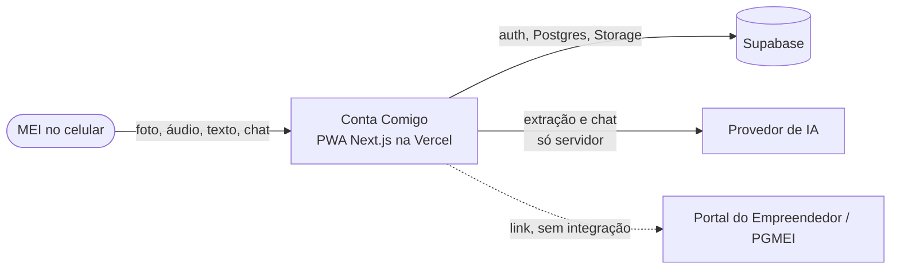
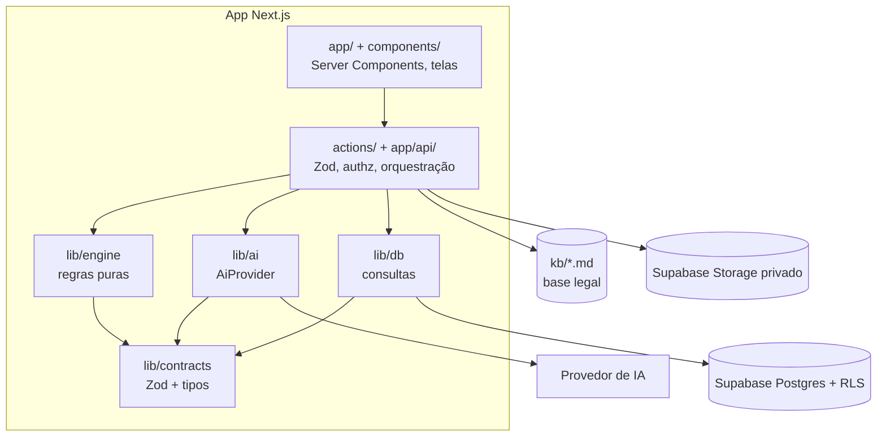

# ARQUITETURA — Conta Comigo

Monólito modular Next.js (App Router) + Supabase, deploy na Vercel. Decisões em `docs/adr/`.

## Atributos de qualidade (em ordem)

1. **Correção fiscal:** número de imposto/limite só sai de `lib/engine` (puro, testado). A IA extrai e explica; nunca calcula.
2. **Segurança e privacidade:** dado financeiro isolado por usuário (RLS + authz na action), mínimo coletado, áudio nunca gravado. Ver `AMEACAS.md` e `LGPD.md`.
3. **Entregabilidade:** 4 pessoas (2 iniciantes) em 8 dias. Pastas com dono, contratos fixos e mocks: ninguém espera ninguém.

## C4 nível 1 — contexto

## C4 nível 2 — contêineres e módulos

## Camadas e regra de dependência

`app/`, `components/` → `actions/` (ou `app/api/`) → { `lib/db`, `lib/ai`, `lib/engine` } → `lib/contracts`

| Camada | Pode importar | Não pode |
|---|---|---|
| `lib/contracts` | `zod` | tudo o mais |
| `lib/engine` | `lib/contracts`, `zod` | next, react, supabase, SDK de IA, fs, outras camadas |
| `lib/ai`, `lib/db` | `lib/contracts` (+ SDK do provedor / cliente supabase) | engine, uma à outra |
| `actions/`, `app/api/` | todas as `lib/*` | — (sem regra de negócio: só valida, autoriza, chama e devolve `Resultado<T>`) |
| `app/`, `components/` | `actions/`, `lib/contracts` | `lib/db`, `lib/ai` |

**Como é cumprida:** `eslint.layers.mjs` (`no-restricted-imports`, sem dependência nova) + `tests/camadas.test.ts` (allowlist: falha se `lib/engine` ou `lib/contracts` importar algo fora dela).

**Acoplamento por interface só onde há 2 implementações:** `AiProvider` (real em `lib/ai`, falso em `lib/contracts/mocks.ts`). `lib/db` exporta funções simples, sem interface de repositório.

## Fluxos

- **Ingestão (M2–M4):** `/api/ingest` (FormData) → sessão → Zod `IngestRequest` → checa `ai_usage` → `AiProvider.extrair` (imagem/áudio em memória) → Zod `IngestResponse` → rascunhos voltam para a tela. **Nada é gravado**, nem o arquivo.
- **Confirmação:** action `confirmar` → sessão → Zod `ConfirmarRequest` (revalida tudo; o que veio da IA não tem privilégio) → se houver imagem: grava no Storage + linha em `documentos` → `INSERT` em `lancamentos`.
- **Dashboard (M6/M7):** action lê perfil + lançamentos do ano → `lib/engine` (resumoMes, statusLimiteMei, projecaoAnual, proximoVencimentoDas, valorDas, gerarAlertas) → `DashboardResponse`. Alertas calculados na leitura.
- **Chat (M8):** `/api/chat` aceita só `role=user` → action monta `ContextoChat` (perfil + dashboard do engine + trechos de `kb/` por palavra-chave) → `AiProvider.responder` → fontes só de `kb/`. Histórico fica no navegador.
- **Exclusão de conta:** apagar arquivos do Storage → `auth.admin.deleteUser` (secret key só no servidor) → cascade. Ver `DADOS.md`.

## Mocks

`NEXT_PUBLIC_USE_MOCKS=true`: as actions devolvem `lib/contracts/mocks.ts` e usam `mockAiProvider`. O front fica pronto antes do back; desligar a flag não muda nenhum tipo.
