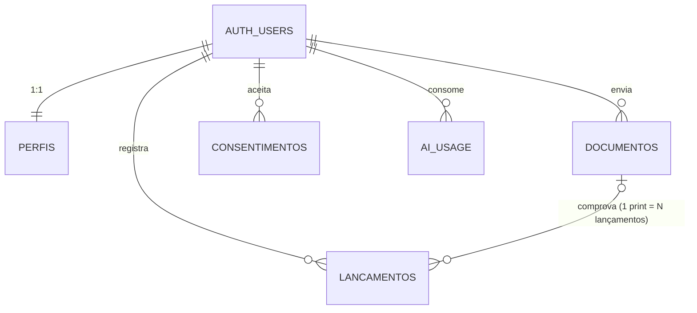

# DADOS — Conta Comigo

Modelo mínimo para o MVP (M1–M8). Postgres no Supabase. Contratos em `lib/contracts`.
Regras gerais: PK `uuid` · `user_id` em toda tabela (FK `auth.users`, `on delete cascade`) ·
dinheiro `bigint` em centavos · instantes `timestamptz` (UTC) · datas de calendário `date`
(fuso America/Sao_Paulo resolvido na borda) · RLS ligado em todas as tabelas.

## ER

## Modelo lógico (3FN, sem desnormalização)

**perfis** — 1 por usuário (M1)
| coluna | tipo | regra |
|---|---|---|
| user_id | uuid PK | FK auth.users, cascade |
| nome_negocio | text | NOT NULL, 1–80 |
| eh_mei | boolean | NOT NULL |
| atividade | text | CHECK in (`comercio`,`servicos`,`ambos`) — define o DAS |
| uf | char(2) | CHECK `^[A-Z]{2}$` |
| municipio | text | NOT NULL, 1–80 |
| data_abertura | date | NOT NULL, ≥ 1990-01-01 — limite proporcional no ano de abertura |
| receita_inicial_centavos | bigint | NOT NULL default 0, ≥ 0 — faturamento do ano antes do app |
| criado_em, atualizado_em | timestamptz | default now() |

**documentos** — imagem (foto/print) gravada no Storage **só ao confirmar**. Áudio nunca vira documento.
| coluna | tipo | regra |
|---|---|---|
| id | uuid PK | `gen_random_uuid()` |
| user_id | uuid | NOT NULL FK |
| storage_path | text | UNIQUE, formato `{user_id}/{id}.{ext}` |
| mime | text | CHECK in (`image/jpeg`,`image/png`,`image/webp`) |
| tamanho_bytes | int | CHECK 1–5 MiB |
| criado_em | timestamptz | default now() |
| | | UNIQUE (id, user_id) — alvo da FK composta |

**lancamentos** — só confirmados (rascunho não é persistido)
| coluna | tipo | regra |
|---|---|---|
| id | uuid PK | |
| user_id | uuid | NOT NULL FK |
| documento_id | uuid NULL | FK **composta** (documento_id, user_id) → documentos(id, user_id) `on delete set null (documento_id)`: impede apontar para documento de outro usuário |
| tipo | text | CHECK in (`receita`,`despesa`) |
| data | date | CHECK 2000-01-01 a 2100-12-31 (Zod barra data futura) |
| valor_centavos | bigint | CHECK > 0 e ≤ 1.000.000.000 |
| categoria | text | CHECK nos 12 valores de `Categoria` (sem tabela de domínio: lista fixa) |
| descricao | text | NOT NULL, 1–200 |
| contraparte | text NULL | ≤ 120 (texto livre, sem entidade própria) |
| forma_pgto | text NULL | CHECK in (`pix`,`cartao`,`dinheiro`,`boleto`,`outro`) |
| origem | text | CHECK in (`foto`,`audio`,`texto`,`print`,`manual`) |
| criado_em, atualizado_em | timestamptz | trigger atualiza `atualizado_em` |

**consentimentos** — prova do aceite (LGPD). Só insert; revogar = preencher `revogado_em`.
| coluna | tipo | regra |
|---|---|---|
| id | uuid PK | |
| user_id | uuid | NOT NULL FK |
| finalidade | text | CHECK in (`termos_uso`,`privacidade`,`envio_ia`) |
| versao | text | NOT NULL (ex.: `2026-11-23`) |
| aceito_em | timestamptz | default now() |
| revogado_em | timestamptz NULL | |
| | | UNIQUE (user_id, finalidade, versao) |

**ai_usage** — teto diário de custo de IA por usuário
| coluna | tipo | regra |
|---|---|---|
| user_id | uuid | FK, PK composta |
| dia | date | PK composta (dia em America/Sao_Paulo) |
| chamadas | int | ≥ 0 |
| custo_centavos | int | ≥ 0 |

## Estados e transições

- **Rascunho** existe só na tela (`IngestResponse`). Confirmar = `INSERT` após revalidar com `LancamentoInput` no servidor.
- **Lançamento**: `confirmado` é o único estado. Editar = `UPDATE` (atualiza `atualizado_em`); excluir = `DELETE` definitivo. Sem soft delete e sem audit_log (corte consciente por prazo, ver ADR-004).
- **Documento**: ao excluir o último lançamento que o usa, a action apaga o arquivo no Storage e a linha.

## RLS e Storage

- `perfis`, `lancamentos`: select/insert/update/delete com `user_id = (select auth.uid())`.
- `documentos`: select/insert/**delete** do próprio usuário; sem update. O delete é necessário: a action apaga a linha ao excluir o último lançamento que a usa.
- `consentimentos`: select/insert do próprio usuário; o único update é de `revogado_em` (GRANT por coluna). Sem `check` entre `revogado_em` e `aceito_em`: compararia horário do app com `now()` do banco e quebra com skew de relógio.
- `ai_usage`: **só select** para o usuário. Escrita só no servidor via `registrar_uso_ia(p_user_id, p_custo_centavos)` (`security definer`, EXECUTE só para `service_role`), senão o usuário zeraria o próprio contador.
- **GRANT explícito:** o projeto tem acesso automático a novas tabelas desligado. Cada tabela recebe `GRANT` só para `authenticated` (anon: nada). `service_role` **não** tem GRANT de tabela (menor privilégio): o servidor usa o client do usuário; a secret key só faz Storage, `auth.admin` e `registrar_uso_ia`.
- Storage: bucket **privado** `documentos`; policy em `storage.objects` exige `(storage.foldername(name))[1] = auth.uid()::text`. Leitura por URL assinada curta.

## Exclusão de conta (LGPD)

Action no servidor, nesta ordem: (1) listar e apagar os arquivos de `documentos/{user_id}/` pela API do Storage; (2) apagar o usuário pela API admin (`auth.admin.deleteUser`, secret key só no servidor) → `cascade` apaga todas as linhas. O Storage **não** cai em cascata, por isso vem antes. Se (1) falhar, aborta sem apagar o usuário.

## Consultas principais e índices

| # | Consulta | Índice |
|---|---|---|
| 1 | Receitas do ano (limite MEI): `sum(valor) where user_id=? and tipo='receita' and data between ? and ?` | `lancamentos (user_id, data)` |
| 2 | Lista do mês (M5): `where user_id=? and data >= ? and data < ? order by data desc` | mesmo |
| 3 | Resumo do mês + despesas por categoria (M6): mesmos filtros, agregação no `lib/engine` | mesmo |
| 4 | Últimos 3 meses para alertas (M7) | mesmo |
| 5 | Perfil do usuário | PK |
| 6 | Uso de IA de hoje (antes de cada chamada) | PK (user_id, dia) |

Mais: `documentos (user_id)` (exportar/excluir) e `lancamentos (documento_id, user_id)` (FK composta; o índice parcial não conta para o linter do Supabase). Volume por usuário é pequeno (centenas de linhas/ano): nada de particionamento nem paginação keyset; lista do mês sem paginação.
